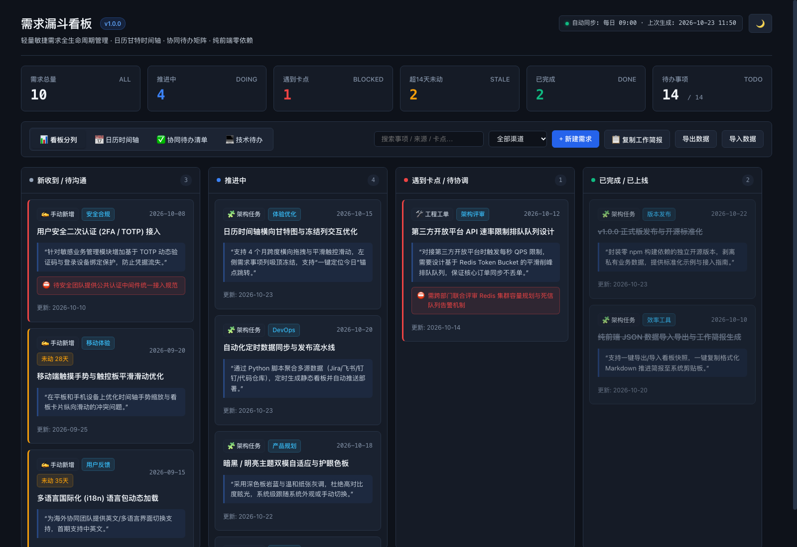
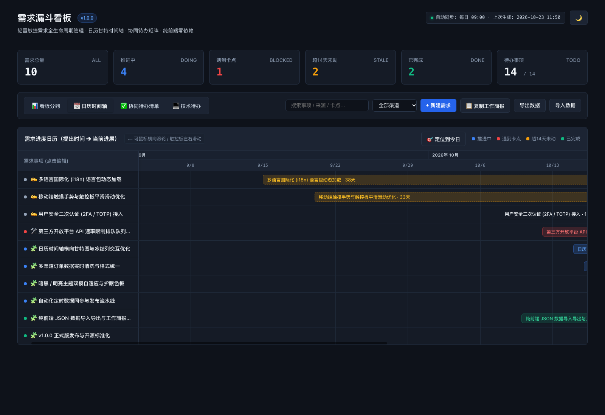
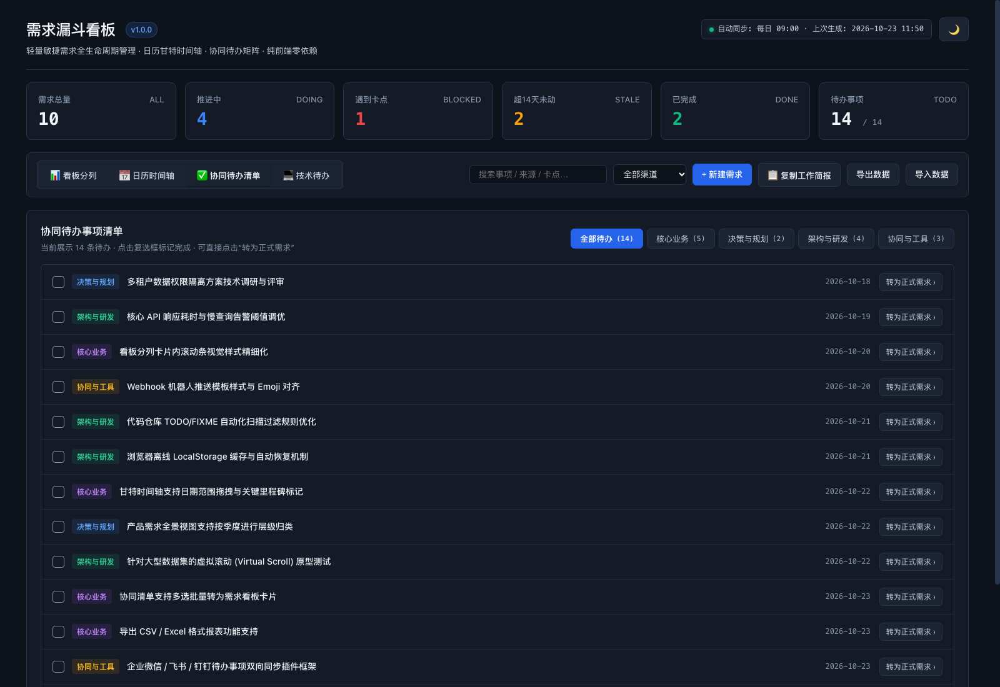

# 需求漏斗看板 (Demand Funnel Board) · v1.0.0

<p align="center">
  
  
  
  
  
</p>

<p align="center">
  <strong>面向敏捷产研、数字化运营与技术团队的轻量级全生命周期需求管理看板。</strong><br>
  四阶漏斗看板 · 日历横向甘特图（带冻结列） · 协同待办矩阵 · 技术债务跟踪 · 纯前端单文件零构建依赖
</p>

---

## 📖 目录 (Table of Contents)
- [✨ 项目亮点](#-项目亮点)
- [🖼️ 界面预览](#️-界面预览)
- [🚀 快速开始](#-快速开始)
- [🛠️ 数据架构与同步](#️-数据架构与同步)
- [🔒 数据安全与脱敏说明](#-数据安全与脱敏说明)
- [📁 目录结构](#-目录结构)
- [📄 开源协议](#-开源协议)

---

## ✨ 项目亮点

1. **四阶需求全生命周期漏斗 (Funnel Kanban)**
   - 标准 4 列分流：`新收到/待沟通` ➔ `推进中` ➔ `遇到卡点/待协调` ➔ `已完成/已上线`。
   - 核心健康度指标：需求总量、推进中、卡点事项、超14天未动滞留预警、已完成、待办完成率。
   - **分列高度视口保护**：分列设置内部纵向滚动 (`max-height: calc(100vh - 290px)`)，杜绝卡片过多时的纵向无限拉伸。

2. **日历横向甘特时间轴 (Calendar Timeline)**
   - 铺展 4 个月跨度（7月～10月）横向日历刻度，支持触控板/滚轮极速平滑滑动与鼠标拖拽平移。
   - **左侧冻结列 (Freeze Column)**：无论时间轴横向滑到哪里，左侧需求事项标题栏始终稳稳吸附在最左侧，绝不丢失上下文。
   - **一键定位今日 (`🎯 定位到今日`)**：平滑滚动直接聚焦当天基准线。

3. **分类协同待办清单 (Categorized Todos)**
   - 交互式打勾完成、进度条即时统计。
   - 维度自由切换：`全部待办`、`核心业务`、`决策与规划`、`架构与研发`、`协同与工具`。
   - 支持一键将待办事项升级为需求漏斗卡片（`转为正式需求 ›`）。

4. **代码技术债务监控 (Tech Debt / Code TODOs)**
   - 自动扫描项目中未完成的 `TODO` / `FIXME` 标记，统计技术债务规模与具体源码行号。

5. **人体工学视觉设计 (Visual Ergonomics)**
   - 护眼深色板岩蓝暗黑模式 (`#0e121a` / `#151b26` / `#1a2230`)，消除屏幕眩光与高对比度视疲劳。
   - 支持深浅双模主题无缝切换，持久化至浏览器 `localStorage`。
   - 接入 Apple SF Pro / PingFang SC 原生排版体系，字号与行高经专业微调。

6. **零构建与极速交付 (Zero Build Dependency)**
   - 纯原生 HTML5 / CSS3 / ES6+，无需 `npm install`、`webpack`、`vite` 等繁重的前端工程环境。
   - 单文件即插即用，可部署至 GitHub Pages、Vercel、Cloudflare Pages、Nginx 或直接双击本地打开。
   - 支持一键复制格式化 Markdown 推进工作简报至剪贴板，支持 JSON 快照导出与导入。

---

## 🖼️ 界面预览

### 1. 需求漏斗看板 (Kanban Board)


### 2. 日历横向甘特时间轴 (Calendar Timeline Gantt)


### 3. 协同待办事项清单 (Todos Checklist)


---

## 🚀 快速开始

### 方式一：直接在浏览器中打开 (零安装)
```bash
git clone https://github.com/<your-username>/demand-funnel-board.git
cd demand-funnel-board
open index.html   # macOS 直接打开，Windows 用户双击 index.html 即可
```

### 方式二：使用 Python 生成与更新数据
项目自带零第三方依赖的 Python 聚合脚本：
```bash
# 1. 使用默认示例数据生成
python3 scripts/generate.py

# 2. 扫描指定代码库中的 TODO/FIXME 标签并注入看板
python3 scripts/generate.py --scan-code

# 3. 指定您自定义的 JSON 数据源文件
python3 scripts/generate.py --data path/to/my-data.json
```

---

## 🛠️ 数据架构与同步

看板页面内部自带一个完全解耦的数据占位脚本块：
```html
<script type="application/json" id="board-data">
{
  "generatedAt": "2026-10-23 12:00",
  "requirements": [ ... ],
  "todos": [ ... ],
  "codeTodos": [ ... ]
}
</script>
```

### 字段说明
* `requirements`:
  * `id`: 唯一标识符
  * `title`: 需求名称
  * `source`: 提出渠道或提出人
  * `date`: 提出日期 (`YYYY-MM-DD`)
  * `status`: 状态枚举 (`todo` / `doing` / `blocked` / `done`)
  * `updated`: 最后更新日期 (`YYYY-MM-DD`)
  * `quote`: 原始沟通背景或详细描述
  * `blocker`: 卡点原因（当状态为 blocked 时高亮展示）
  * `channel`: 渠道类型 (`ticket`, `project_task`, `manual`, `chat`)
* `todos`:
  * `id`: 待办 ID
  * `subject`: 待办内容
  * `dept`: 所属部门/分类 (`核心业务`, `决策与规划`, `架构与研发`, `协同与工具`)
  * `date`: 记录日期

---

## 🔒 数据安全与脱敏说明

本项目在设计上做到了**引擎与数据的彻底分离**：
* 核心看板渲染与交互完全基于内嵌的 JSON 数据。
* 开源仓库中**默认仅包含通用、标准化的演示数据 (Sample Data)**，绝不包含任何真实的内部人员姓名、企业商业敏感信息或生产接口。
* `.gitignore` 中默认已将 `private/`、`sources/`、`*.local.json` 列入忽略名单，防止您在本地对接企业真实数据源时不慎提交到公开版本库。

---

## 📁 目录结构

```text
demand-funnel-board/
├── assets/                  # 预览截图与静态资源
│   ├── kanban-preview.png
│   ├── timeline-preview.png
│   └── todos-preview.png
├── data/
│   └── sample-data.json     # 标准化演示数据集 (已完全脱敏)
├── scripts/
│   └── generate.py          # 零依赖 Python 数据生成与代码扫描引擎
├── index.html               # 核心看板页面 (单文件，开箱即用)
├── CHANGELOG.md             # 版本变更记录
├── LICENSE                  # MIT 开源协议
├── .gitignore               # Git 忽略配置 (含敏感数据防泄漏规则)
└── README.md                # 项目说明文档
```

---

## 📄 开源协议

本项目采用 [MIT License](LICENSE) 授权，允许自由使用、修改、集成与商业化。
欢迎提交 Issue 和 Pull Request 共建！
